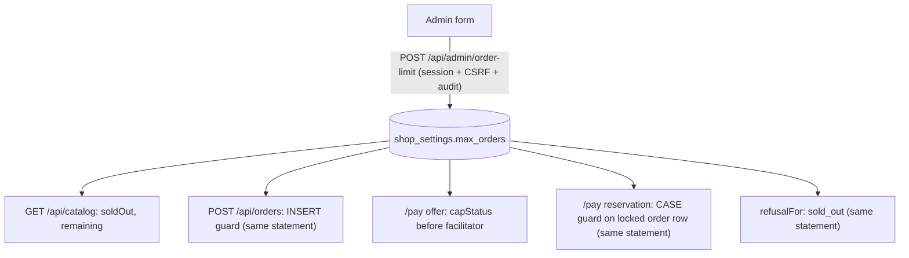

# Admin-Configured Order Limit Implementation Plan

**Goal:** the order limit is stored in the database and set in the admin dashboard (blank or 0 means unlimited). The `MAX_ORDERS` env var is removed.

**Scope:** `db/`, `apps/api` (orderCap, payment, index), `apps/web/src/Admin.tsx`, `App.tsx`, tests, compose/env/docs. This builds on PR #22 (`docs/plans/2026-10-01-privacy-demo-order-limit.md`, *Order cap design*).

**Global constraints**
- The soft-cap semantics and the 2026-09-23 settlement-claims ADR are unchanged:
  - the limit is checked only before broadcast;
  - reserved payments always proceed;
  - `X-Payment-Refused` is sent only when the hash is reserved nowhere;
  - reservation takes the order-row lock via a single CASE guard.
- The user approved removing the env var and the tests that only cover its "invalid value fails closed" path.

---

## Summary

`shop_settings` gains `max_orders int NOT NULL DEFAULT 0 CHECK (0..1,000,000)`. Since the value is validated when it's written, the `invalid` cap state disappears. `orderCap.ts` stops parsing env and exposes `CAP_SQL = (SELECT max_orders FROM shop_settings WHERE id=1)`. Every guard reads the limit **inside the same SQL statement**, so it no longer travels as a parameter:
- the order-creation INSERT;
- the reservation CASE;
- `refusalFor`.

The offer check and the catalog read the limit and the sold count in one query (`capStatus`). A new `POST /api/admin/order-limit {maxOrders: integer | null}` validates and saves the limit. Like `/api/admin/pause`, it sits behind the existing admin session, CSRF and audit middleware. The admin dashboard gains a small form showing *sold / limit / oversold*.

## Diagram: where the limit is read



## Change map

```
db/012_admin_order_limit.sql             +4   ⚠ schema: shop_settings.max_orders + named CHECK (drop/add pattern)
apps/api/src/orderCap.ts                 ~30  CAP_SQL + capStatus(); env parsing removed
apps/api/src/payment.ts                  ~20  ⚠ funds path: guards read CAP_SQL; $5/$6 params removed
apps/api/src/index.ts                    ~40  ⚠ public/admin API: POST /api/admin/order-limit; catalog drops "misconfigured"
apps/web/src/Admin.tsx                   +45  limit form; invalid-env banner removed
apps/web/src/App.tsx                     ~6   drop "misconfigured" handling
apps/api/test/privacy-and-cap.test.mjs   ~40  limit set via admin endpoint; env-invalid test + race variant removed; new admin tests
apps/api/test/legal.test.mjs             -20  env parsing + env-invalid creation tests removed
docker-compose.yml, .env*.example        -3   MAX_ORDERS removed
README.md, docs/DEPLOYMENT.md, docs/OPERATIONS.md, docs/OPEN_SOURCE_CHECKLIST.md  ~10  describe admin setting
```

## Risk table

| # | Change | Risk | Why | Review this |
|---|---|---|---|---|
| 1 | Reservation CASE guard reading `CAP_SQL` | High | Funds path; the lock must still be taken before any filter | Read line-by-line; race test must still block |
| 2 | Order-limit endpoint | Medium | New admin write; validation and auth | Read |
| 3 | Migration 012 | Medium | Schema; idempotent; default 0 = unlimited for existing installs | Read |
| 4 | Removed tests | Medium | Tests are normally immutable; removal is user-approved and limited to the env path | Check that only env-path tests go |
| 5 | Admin form, docs | Low | UI/copy | Skim |

## Acceptance criteria

- [ ] `POST /api/admin/order-limit` without a session → 401; with a valid session: `{maxOrders: 3}` → 200; `null`/`0` → unlimited; `-1`, `1.5`, `"3"`, `1000001`, missing key → 400 (test: `privacy-and-cap.test.mjs › admin sets and validates the order limit`)
- [ ] Lowering the limit to the current sold count makes the catalog sold out and the next order 409, with no restart (same test)
- [ ] Every existing cap, erasure and refusal test still passes, with the limit set through the admin endpoint instead of env:
  - `enforces MAX_ORDERS before broadcast…` (renamed to "the order limit")
  - `a reservation still being written is never reported as refused`
  - erasure tests
  - `payment-refused.test.mjs`
- [ ] The race test still proves that the reservation blocks on the order-row lock when the limit is reached
- [ ] Migrations applied twice succeed (`production-recovery.test.mjs`)
- [ ] `grep -rn MAX_ORDERS` → only in `docs/plans/` history
- [ ] `npm run typecheck`, `npm test` with `TEST_DATABASE_URL` (0 skipped), `npm run build`, `docker compose config`

## Tasks

### Task 1: The limit lives in `shop_settings` (check: migrations apply twice)
`db/012_admin_order_limit.sql`:
`ALTER TABLE shop_settings ADD COLUMN IF NOT EXISTS max_orders int NOT NULL DEFAULT 0;`, then the repo's usual pattern (`db/002`, `db/008`): `ALTER TABLE shop_settings DROP CONSTRAINT IF EXISTS shop_settings_max_orders_check; ALTER TABLE shop_settings ADD CONSTRAINT shop_settings_max_orders_check CHECK (max_orders BETWEEN 0 AND 1000000);`. That way re-running never duplicates the constraint.
Add 012 to the migration list in `docs/DEPLOYMENT.md`.

### Task 2: Every guard reads the limit from the database (check: cap and race tests)
- `orderCap.ts`:
  - `CAP_SQL`;
  - `SOLD_ORDERS_SQL` (unchanged);
  - `capStatus(env)` returns `{maxOrders, sold}` from one query.
  
  Remove `orderCapFor` and `capGuardParams`.
- `payment.ts`:
  - **Offer:** `if (!signature && !o.signed_tx_hash)`, then erased/window → ORDER_CLOSED; `maxOrders > 0 && sold >= maxOrders` → SOLD_OUT. The invalid-503 branch goes.
  - **Reservation CASE `ELSE` branch:** `(${CAP_SQL} = 0 OR ${SOLD_ORDERS_SQL} < ${CAP_SQL})`. It stays inside the CASE over `locked.*`, so the guard still cannot be hoisted above the lock.
  - **`refusalFor` sold_out:** `(${CAP_SQL} <> 0 AND ${SOLD_ORDERS_SQL} >= ${CAP_SQL})`.
- `index.ts`:
  - **Order creation guard:** the same expression.
  - **Catalog:** `maxOrders` is `null` when 0; `remaining` and `soldOut` come from `capStatus`; the `misconfigured` availability goes.
  - **Admin orders `orderCap`:** `{maxOrders, sold, oversold}`, with `valid` removed.

### Task 3: Admins can set the limit (check: `admin sets and validates the order limit`)
- **API:** `POST /api/admin/order-limit`:
  - body `{maxOrders}`, which must be `null` or an integer 0..1,000,000; anything else → 400 "Enter a whole number between 0 and 1000000, or leave empty for unlimited";
  - `UPDATE shop_settings SET max_orders=$1 WHERE id=1`, returning `{maxOrders}`;
  - it inherits the existing admin auth/CSRF/audit middleware like `/api/admin/pause`.
- **Missing `maxOrders` key** → 400 (`null` must be sent explicitly for unlimited).
- **Admin UI:** remove `valid` from the `orderCap` type and drop the invalid banner (`Admin.tsx` type and banner). Add an "Order limit" number input (blank = unlimited), Save button and a status line "sold of limit (oversold …)". Saving uses the same request helper as Pause.

### Task 4: The env var is gone (check: grep)
Remove `MAX_ORDERS` from compose and the env examples. In the docs, describe the admin control and keep the soft-cap and oversold explanation.

### Task 5: Tests follow the new source of truth (check: full suite)
- **Removed (env-only, user-approved):**
  - `legal.test.mjs › MAX_ORDERS parsing…`
  - `legal.test.mjs › an invalid order cap fails closed…`
  - `privacy-and-cap.test.mjs › an invalid MAX_ORDERS fails closed…`
  - the `an invalid cap` variant of the race test

  Their configuration-error state no longer exists, because the DB CHECK and the endpoint reject invalid values.
- **Changed (user-visible, deliberate):**
  - `withShop` sets the limit through `POST /api/admin/order-limit` (exercising the endpoint) instead of `env.MAX_ORDERS`.
  - The admin `orderCap` assertion drops `valid: true`, because that field no longer exists: `{ maxOrders: 1, sold: 2, oversold: 1 }`.
  - The `sign` helper's `{ ...env, MAX_ORDERS: '' }` override is removed. It no longer does anything, so offer requirements must be fetched before the limit closes; every test already does this. A comment documents it.
  - The `orderCapFor` import is removed from `legal.test.mjs`.

  No other assertions change.
- **Added:** endpoint auth and validation; a limit change takes effect immediately.

---

## Decisions most likely to be wrong
1. **Removing the invalid-config path.** With DB validation there is no invalid state left to fail closed. The CHECK constraint backs this up if someone writes SQL by hand.
2. **Bearer-auth tests.** The tests reach the endpoint through `ADMIN_ALLOW_BEARER`, like the existing admin tests, so the CSRF path is covered only by the existing `admin-security` test and not specifically for this endpoint.

## Assumed / Unsure / Skipped
**Assumed:** the existing admin middleware applies to every `POST /api/admin/*` route (true for `/api/admin/pause`).
**Unsure:** whether an operator wants a confirmation before lowering the limit below the sold count. The plan simply shows "sold out".
**Skipped:** limit change history beyond the existing `admin_audit` row.
